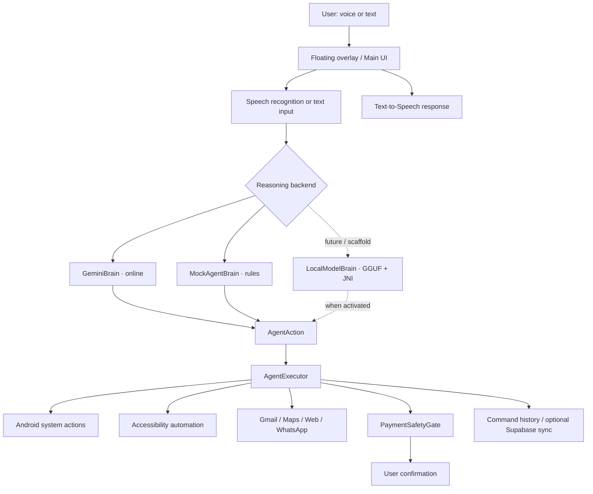

<!--
  Reddy AI — README
  Maintainer: Sunny-H-12-NIAT
-->

<div align="center">


# REDDY AI

### Your Android. Your assistant. Your control.

**A local-first, voice-driven Android AI companion with an on-screen presence, agentic actions, and safety gates.**

<p>
  <a href="https://github.com/Sunny-H-12-NIAT/ReddyAI/stargazers"></a>
  <a href="https://github.com/Sunny-H-12-NIAT/ReddyAI/network/members"></a>
  <a href="https://github.com/Sunny-H-12-NIAT/ReddyAI"></a>
  <a href="https://kotlinlang.org/"></a>
  <a href="https://developer.android.com/jetpack/compose"></a>
  
</p>

<p>
  <a href="#-overview">Overview</a> ·
  <a href="#-features">Features</a> ·
  <a href="#-architecture">Architecture</a> ·
  <a href="#-getting-started">Get started</a> ·
  <a href="#-configuration">Configuration</a> ·
  <a href="#-roadmap">Roadmap</a>
</p>

<br/>

> [!WARNING]
> **Reddy AI is an experimental alpha project.** Some integrations require credentials and user-granted Android permissions. The on-device Qwen3/llama.cpp implementation is currently a scaffold and is **not ready for a working offline-model experience**. Read the implementation notes below before expecting every capability to work.

</div>

---

## ✨ Overview

Reddy AI is an Android personal-assistant project built around a simple idea: **an assistant should be able to understand a request and help carry it out on the device you already own.**

Instead of being only a chat screen, Reddy AI combines a floating companion, voice input and speech output, an agent/action layer, Android system intents, and optional online services. The codebase includes a model abstraction intended to support multiple reasoning backends, including Gemini, lightweight rule-based handling, and a future local GGUF model through JNI.

The project is being developed with a **local-first direction**: keep device interaction and user control close to the Android app, use remote services only where a feature requires them, and make high-impact actions visible to the user.

### Design principles

- **Device-native:** Android services and intents are used for device-level actions.
- **Voice-forward:** speak to Reddy or type into the companion interface.
- **Modular reasoning:** model logic is separated from action execution.
- **User-controlled:** sensitive permissions and payment-related automation have explicit safety handling.
- **Hybrid by design:** online AI and integrations can coexist with local/rule-based paths.

## 🚀 Features

The table below reflects the repository implementation, not a promise that every path works on every device.

| Capability | Implementation in the codebase | Status / dependency |
|---|---|---|
| Floating Reddy companion | Foreground overlay service + Jetpack Compose UI | Implemented; requires overlay permission |
| Voice input | Android `SpeechRecognizer` | Implemented; recognizer availability and microphone permission required |
| Voice responses | Android `TextToSpeech` | Implemented; device TTS engine/language required |
| Wake phrase mode | Configurable listening mode and “Hey Reddy” recognition loop | Experimental; uses Android speech-recognition service, not a dedicated always-on wake-word engine |
| Agent action routing | `AgentBrain` → `AgentAction` → `AgentExecutor` | Implemented in source |
| Gemini reasoning | Gemini API client with configurable model | Requires a Gemini API key and network |
| Rule-based fallback | `MockAgentBrain` intent matching | Available as a fallback path |
| Android actions | App launch, calls, alarms, timers, maps navigation, camera, screenshot, web search and WhatsApp intents | Depends on Android permissions/apps and device behaviour |
| Accessibility automation | Screen inspection and UI interaction service | Requires user-enabled Accessibility Service; experimental |
| Gmail | Read recent messages, create drafts and send email | Requires Google sign-in/OAuth configuration and Gmail scopes |
| Payment safety gate | Screen-text keyword checks and blocking confirmation activity | Implemented as a safety layer; not a guarantee of payment/fraud detection |
| Supabase command-log sync | REST client for `command_logs` | Optional; requires project URL, key, table and appropriate policies |
| Local Qwen3 model | `LocalModelBrain` + JNI bridge scaffold | **Not ready:** source marks it as a stub pending native llama.cpp libraries/headers and activation wiring |

<details>
<summary><strong>What can I ask Reddy?</strong></summary>

Examples corresponding to action types present in the project:

- “Open WhatsApp”
- “Call [contact]”
- “Set an alarm for 6:30”
- “Set a timer for 10 minutes”
- “Navigate to [place]”
- “Take a screenshot”
- “Search the web for [query]”
- “Check my recent emails”
- “Draft an email to [recipient]”
- “Open [installed app]”
- “Automate [app] to [task]”

Actual results depend on the selected brain, permissions, connected accounts, supported apps, and current implementation state. Do not use these examples as evidence that every integration has been tested end-to-end.

</details>

## 🧠 Architecture

Reddy separates **reasoning** from **execution**. A brain turns the user's request (and optional screen context) into a typed `AgentAction`. The executor maps that action to Android or integration code.



### Main code map

| Path | Responsibility |
|---|---|
| `ReddysAI/app/src/main/java/com/reddysai/app/MainActivity.kt` | Main screen, setup and permission flows |
| `agent/AgentBrain.kt` | Brain contract and structured `AgentAction` definitions |
| `agent/AgentExecutor.kt` | Executes actions on Android and through integrations |
| `brain/GeminiBrain.kt` | Gemini API reasoning |
| `brain/LocalModelBrain.kt` | Qwen3/llama.cpp integration scaffold |
| `service/OverlayService.kt` | Floating companion, voice input, TTS and foreground lifecycle |
| `service/ReddyAccessibilityService.kt` | Screen inspection and accessibility interaction |
| `safety/PaymentSafetyGate.kt` | Payment-related confirmation gate |
| `gmail/GmailClient.kt` | Gmail API operations |
| `data/ReddysAISettings.kt` | Local app preferences |
| `data/SupabaseClient.kt` | Optional command-log REST sync |
| `app/src/main/cpp/` | JNI bridge and native build configuration |

## 🛠️ Tech stack

<p>
  
  
  
  
  
  
  
  
</p>

- **Language:** Kotlin
- **UI:** Jetpack Compose, Material 3
- **Android:** Android SDK, foreground services, SpeechRecognizer, TextToSpeech, Accessibility Service, system intents
- **Async:** Kotlin Coroutines
- **Cloud AI:** Gemini Generative Language API
- **Email:** Google Sign-In and Gmail API
- **Networking:** OkHttp
- **Optional backend:** Supabase REST API
- **Local inference direction:** Qwen3 GGUF, llama.cpp, JNI and CMake (native runtime currently incomplete)

## 📋 Requirements

Based on the current Gradle configuration:

- Android Studio with a compatible Android Gradle Plugin 8.13.2 toolchain
- JDK 11-compatible project compilation
- Android SDK Platform 36
- Gradle wrapper 8.13 (included)
- Android device or emulator running **Android 10 / API 29 or later**
- **ARM64 (`arm64-v8a`) device target** for the current configured native ABI

Some capabilities need a physical device and cannot be meaningfully tested in a standard emulator, especially overlay behaviour, calls, microphone input and accessibility-driven interaction.

## ⚡ Getting started

### 1. Clone the repository

```bash
git clone https://github.com/Sunny-H-12-NIAT/ReddyAI.git
cd ReddyAI
```

### 2. Open the Android project

The Android Studio project is nested one directory below the repository root:

```text
ReddyAI/
└── ReddysAI/
    ├── app/
    ├── gradle/
    ├── build.gradle.kts
    ├── settings.gradle.kts
    └── gradlew
```

Open **`ReddysAI/`** in Android Studio (not the outer Git repository folder).

### 3. Configure local properties

Create or edit `ReddysAI/local.properties` (this file is git-ignored):

```properties
sdk.dir=/absolute/path/to/your/Android/Sdk
OAUTH_WEB_CLIENT_ID=YOUR_GOOGLE_OAUTH_WEB_CLIENT_ID
```

Use your actual Android SDK path. Add the Google OAuth Web Client ID only when configuring the Google sign-in/Gmail flow.

### 4. Build and run

From the `ReddysAI/` directory:

**Windows PowerShell**
```powershell
.\gradlew.bat assembleDebug
```

**macOS / Linux**
```bash
./gradlew assembleDebug
```

Install the generated debug APK from:

```text
ReddysAI/app/build/outputs/apk/debug/app-debug.apk
```

> [!NOTE]
> The repository currently comments out `externalNativeBuild` in `app/build.gradle.kts`. The CMake file also expects prebuilt llama.cpp shared libraries and headers that are not supplied by the current project tree. The Android app's local-model path therefore should not be treated as build-ready until that native setup is completed.

## 🔐 Configuration

### Gemini (online reasoning)

The app has a settings field for a Gemini API key and a configurable Gemini model (the current default in source is `gemini-2.0-flash`). Add your key through the app's configuration UI.

- Internet access is required for Gemini requests.
- Never commit API keys, OAuth client secrets, access tokens, or private credentials.
- For production, prefer a backend-mediated secret strategy instead of embedding a long-lived secret in a distributed client.

### Google Sign-In and Gmail

Gmail operations require Google OAuth configuration and the Gmail scopes requested by the app:

- `gmail.readonly`
- `gmail.send`
- `gmail.compose`

Configure the OAuth client correctly in Google Cloud Console, including the Android app identity and signing certificate. Gmail access is optional; the app should be usable without connecting an account, but email actions will not work until sign-in succeeds.

### Supabase (optional command-log sync)

The app exposes fields for a Supabase project URL and API key, and writes command log entries to the `command_logs` REST endpoint.

Before enabling it:

1. Create a Supabase project.
2. Create the expected `command_logs` table and columns matching the app's command-log payload.
3. Configure Row Level Security and policies for the intended access model.
4. Enter the project URL and an appropriately scoped key in the app.

> [!CAUTION]
> Do not put a Supabase `service_role` key in an Android app. Client-side values can be extracted from an APK. Use only a publishable/anon key with restrictive RLS policies, or move privileged operations behind a trusted backend.

### Permissions

Reddy may request access to capabilities including:

| Permission / setting | Why it is used |
|---|---|
| Microphone | Voice input and wake-phrase listening mode |
| Display over other apps | Floating Reddy companion |
| Accessibility Service | Read visible UI nodes and perform supported UI automation |
| Camera | Capture a photo through an action |
| Contacts | Resolve contact-related actions |
| Phone | Place calls when requested |
| Notifications / foreground service | Keep the overlay service visible and running |
| Internet | Gemini, Gmail and optional Supabase requests |

Grant only the permissions needed for the features you intend to use. You can revoke them at any time in Android Settings.

## 🛡️ Safety and privacy

Device automation is powerful, so it must be treated carefully.

- The code includes a `PaymentSafetyGate` that scans visible screen text for payment/order-related keywords and can show a blocking confirmation screen before automation continues.
- Accessibility access is highly privileged. Review the service behaviour and the text it can inspect before enabling it.
- Gmail access is limited by the OAuth scopes granted by the account.
- Supabase logging is optional and should be configured with appropriate access policies.
- Voice recognition may be handled by the device's speech-recognition provider; do not assume voice processing is fully offline.
- A keyword-based payment gate is a basic guardrail, **not** a complete transaction-security system. Always review purchases and payments yourself.

**Never use Reddy AI to bypass app security, make hidden purchases, or perform actions without the device owner's informed permission.**

## 🧪 Current implementation notes

A few details are especially important for contributors and testers:

1. `OverlayService` currently constructs `GeminiBrain` directly. The settings model contains brain-mode values, but the service wiring should be reviewed before assuming automatic Gemini/local switching is active.
2. `LocalModelBrain` documents itself as a **stub** awaiting llama.cpp shared libraries and headers. Its JNI activation steps are described in source comments.
3. The app's Gradle config currently filters native packaging to `arm64-v8a`.
4. The CMake file expects prebuilt `libllama.so`, `libggml.so`, and `libllama-common.so`, plus llama.cpp headers. Those native artifacts are not present in the tracked source tree.
5. Overlay, speech recognition and accessibility behaviours can vary across Android vendors. Xiaomi/MIUI/HyperOS may require additional background/autostart settings.

These notes are intentionally explicit so contributors can distinguish existing code from planned integration work.

## 🗺️ Roadmap

The roadmap below is a project direction, not a claim that these items are complete.

- [x] Android application foundation with Jetpack Compose
- [x] Floating companion foreground service
- [x] Speech recognition and text-to-speech integration
- [x] Structured agent action model and executor
- [x] Gemini reasoning client
- [x] Accessibility automation foundation
- [x] Payment-related confirmation gate
- [x] Gmail client and optional Supabase REST client
- [ ] Complete and package the llama.cpp native runtime
- [ ] Activate and test Qwen3 GGUF inference on-device
- [ ] Implement reliable model-mode selection and fallback behaviour
- [ ] Add automated unit and instrumentation tests for action routing and safety gates
- [ ] Strengthen transaction safeguards with structured action previews and explicit confirmation
- [ ] Document supported device matrix and measured performance
- [ ] Publish reproducible debug/release builds

## 🤝 Contributing

Contributions, bug reports and thoughtful feature requests are welcome.

1. Fork the repository.
2. Create a focused branch: `git checkout -b feat/your-feature`.
3. Make your changes and test on a suitable Android device.
4. Keep credentials and personal data out of commits and logs.
5. Open a pull request describing the change, permissions involved, and test results.

For changes involving accessibility, email, payments, contacts or calls, explain the user-consent and safety implications in the PR.

## 🐛 Issues and feedback

Found a bug or have an idea?

- [Open an issue](https://github.com/Sunny-H-12-NIAT/ReddyAI/issues)
- [Browse the source](https://github.com/Sunny-H-12-NIAT/ReddyAI)
- Include Android version, device model, reproduction steps and relevant redacted logs.

## 📄 License

No license file is currently present in the repository. Until a license is added, the source is **not automatically granted an open-source reuse license**. Add a license (for example, MIT or Apache-2.0) only after choosing the terms you want to apply.

---

<div align="center">

### Built with curiosity, Kotlin, and a little ambition.

**REDDY AI** · Personal Android AI Assistant

<sub>Created by <a href="https://github.com/Sunny-H-12-NIAT">Sunny-H-12-NIAT</a></sub>

<a href="#reddy-ai">Back to top ↑</a>

</div>
